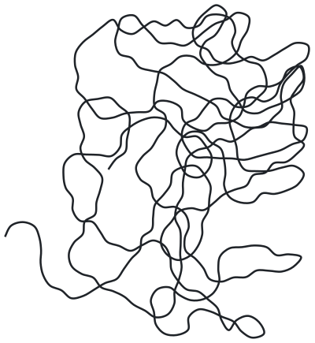
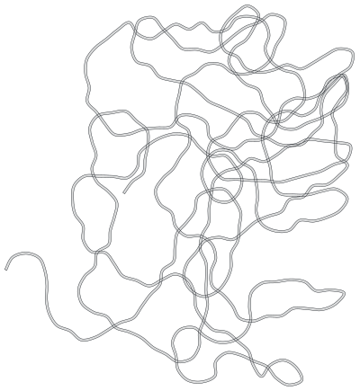

# stroke-outline

[](https://www.npmjs.com/package/stroke-outline)
[](https://github.com/yyyk/stroke-outline/actions/workflows/ci.yml)
[](LICENSE)

A small C++20 library that turns a vector path into the filled outline of its
stroke — the same geometry a 2D canvas produces for `stroke()`, but returned as
a path you can fill, cache, or hit-test. It builds for **native** and
**WebAssembly** from the same sources. The core library (`include/`, `src/`) is
plain, portable C++; Emscripten-specific code is confined to
`bindings/wasm_bindings.cpp`.

Features:

- Input made of lines, quadratic and cubic béziers, and SVG elliptical arcs;
  curves stay curves in the output (no flattening).
- Line joins: miter (with `miter_limit`), bevel, round.
- Line caps: butt, square, round.
- Dashing with `dash_pattern` / `dash_offset`, following SVG: odd-length
  patterns repeat, an all-zero pattern strokes solid, and the pattern restarts
  at every subpath. Zero-length dashes are dots with round/square caps, so
  `[0, gap]` draws a dotted line. A pattern that would produce more than
  ~100,000 dashes strokes the path solid instead of running away.
- Stroke alignment: center, inside, or outside of closed subpaths, relative to
  the fill of the whole path (`fill_rule`: nonzero or even-odd), so holes are
  stroked into the surrounding material. Dashed strokes keep their alignment.
- Opt-in `clip_to_shape`: resolves the outline of closed subpaths into simple
  contours — strokes wider than the shape fill it, strokes wider than a wall or
  overlapping other subpaths stay inside (or outside) the shape, and the result
  fills the same under nonzero and even-odd.
- SVG path `d` strings in and out. Malformed data is handled as SVG does
  (everything before the first error is used); an error message saying what went
  wrong and where is available if you ask for it.
- Invalid input draws nothing instead of producing NaNs: a width that isn't a
  positive finite number, or a non-finite coordinate. A miter limit below 1
  behaves as 1 (always bevel).

**Any size.** Results are the same at any scale — tested from strokes ~1e-5
wide on shapes ~1e-4 across up to a million times larger. Curved outlines stay
within about 0.1% of the stroke width of the exact outline. SVG output keeps
small paths' detail:
`precision` is a minimum number of decimals, raised as needed to keep rounding
within ~1e-4 of the path's size.

**Fill the outline with the nonzero rule** (the default for Canvas `fill()` and
SVG). As with Skia and most stroke outliners, the outline may overlap itself —
for example a wide stroke on a concave shape loops its outer boundary over
itself — and nonzero renders and hit-tests that correctly. Even-odd would punch
holes where it overlaps, and code that needs simple polygons (some
triangulators, boolean ops) has to resolve the overlaps first — or enable
`clip_to_shape`, which does that for closed subpaths.

## Performance

Three inputs, each stroked whole (`bench/inputs/`), and under each its outline
with `clip_to_shape`: a light fill with the outline's contours on top (click a
picture to open it and zoom in).

**Glyphs**: 4 lines of 16 px text in Source Sans Pro (417 contours of lines and
cubics), stroke width 0.5.


**Icons**: 12 outline icons on a 24-unit grid (lines, arcs and curves), stroke
width 2.


**Freehand**: one open path of 400 cubics, stroke width 4 (open paths aren't
clipped).





The time to stroke each whole input once, with the default settings (miter
joins, butt caps) and with `clip_to_shape`:

| Input    | Segments in → out | Settings        | C++ (native) | npm (WebAssembly) |
| -------- | ----------------- | --------------- | ------------ | ----------------- |
| Glyphs   | 3,675 → 17,708    | default         | 7.4 ms       | 17.8 ms (2.4×)    |
|          |                   | `clip_to_shape` | 42.0 ms      | 67.3 ms (1.6×)    |
| Icons    | 94 → 422          | default         | 188 µs       | 459 µs (2.4×)     |
|          |                   | `clip_to_shape` | 930 µs       | 1,606 µs (1.7×)   |
| Freehand | 400 → 2,949       | default         | 1.6 ms       | 3.2 ms (2.0×)     |

Round joins and caps, and dashes, cost about the same as the default (within
about 15%). `clip_to_shape` costs 5–6× the default natively and 3–4× in
WebAssembly on closed shapes; open paths like the freehand one are passed
through, so cost nothing extra. Outlines have about 4.5–7.5 segments per
segment in. The npm times include turning the outline into JavaScript
commands.

Measured on an Apple M5 Pro (macOS 26.7): C++ built with Apple clang 21 (the
`native-release` preset), npm with Node 24.22 and the WebAssembly module built
by Emscripten 7.0. Each time is the median of 7 runs, each repeated for at
least 100 ms. To rerun:

```sh
# C++
cmake --build --preset native-release --target stroke_outline_bench
bin/native/stroke_outline_bench

# npm: the WASM module, then the package and the benchmark
cmake --build --preset wasm-release
cd js && npm run bench
```

`bench/generate-inputs.py` makes the inputs and their pictures (see its header),
and `node js/bench/pictures.mjs` (after `npm run build` in `js/`) the outline
pictures.

## Layout

```
include/stroke_outline/ public headers (portable C++)
src/                    library implementation; src/math/ holds internal headers
bindings/               Embind glue, WASM-only
sandbox/native/         native demo executable
sandbox/web/            Vite + TypeScript browser sandbox
tests/                  doctest unit tests (ctest)
bench/                  benchmark inputs (bench/inputs/) and the native benchmark
cmake/                  helper modules (Emscripten finder, format targets)
```

## Prerequisites

- A C++20 compiler, CMake ≥ 3.21, and Ninja (native build).
- For WASM: the [Emscripten SDK](https://emscripten.org/docs/getting_started/downloads.html).
  The toolchain is auto-detected from `$EMSDK` (after `source emsdk_env.sh`) or a
  Homebrew install (`brew install emscripten`) — no manual toolchain flag needed.
- For the web sandbox: Node.js (any recent LTS).

## Build native

```sh
cmake --preset native
cmake --build --preset native-release      # or native-debug
ctest --preset native-release
./bin/native/stroke_outline_sandbox
```

### Test coverage

Needs Clang (Apple's on macOS, or `llvm-profdata`/`llvm-cov` on your PATH):

```sh
cmake --preset coverage
cmake --build --preset coverage   # runs the tests, prints a per-file summary
open build/coverage/coverage-report/index.html   # annotated source; 0 = line never ran
```

The library, fetched dependencies and tests are instrumented with
`-DSTROKE_OUTLINE_COVERAGE=ON` (see `cmake/Coverage.cmake`); the report leaves
out the tests themselves and the unused reference clipper. Small inline helpers
in headers can show as uncovered even when used.

## Build WASM

```sh
cmake --preset wasm
cmake --build --preset wasm-release
# produces bin/wasm/stroke_outline.{js,wasm,d.ts} (ES6 module, its .wasm, and
# TypeScript types)
```

## Web sandbox (Vite)

```sh
# 1. build the WASM module — publishes it into js/src/wasm/; the sandbox uses
#    the npm package (js/) from source
cmake --preset wasm && cmake --build --preset wasm-release
# 2. run the sandbox with hot reload
cd sandbox/web
npm install
npm run dev        # http://localhost:5173
```

## Using it from C++

```cpp
#include "stroke_outline/stroke_outline.hpp"

using namespace stroke_outline;

StrokeSettings settings;
settings.line_width = 8.0;
settings.line_join = LineJoin::Round;
settings.line_cap = LineCap::Round;
settings.dash = DashSettings { { 20.0, 10.0 }, 0.0 };  // optional

// Stroke SVG path data; the outline is a Path.
std::optional<SvgParseError> error;  // optional: malformed data is stroked up to the error
Path outline = build_outline("M 10 10 H 90 A 20 20 0 0 1 90 50", settings, error);
std::string d = outline.to_svg();
if (error)
    std::cerr << error->message << "\n";  // e.g. "unknown command 'X' at position 14"

// Parse SVG once, then stroke it as often as you like.
Path icon = Path::from_svg("M 0 0 H 100 V 100 H 0 Z M 30 30 V 70 H 70 V 30 Z");
Path thin = build_outline(icon, { .line_width = 2.0 });
Path thick = build_outline(icon, { .line_width = 12.0, .align = StrokeAlign::Inside });

// Or build the path in code.
Path curve = Path {}.move_to(10, 10).line_to(90, 10).quad_to(120, 50, 90, 90);
Path dashed = build_outline(curve, settings);

// Read an outline back without any library geometry types.
outline.for_each({
    .move_to = [](double x, double y) { /* ... */ },
    .line_to = [](double x, double y) { /* ... */ },
    .cubic_to = [](double c1x, double c1y, double c2x, double c2y, double x, double y) { /* ... */ },
    .close = [] { /* ... */ },
});
```

### From another CMake project

Either way, link `stroke_outline::stroke_outline` (it carries the include path
and the C++20 requirement).

**Installed**, with `find_package`:

```sh
cmake --preset native && cmake --build --preset native-release
cmake --install build/native --config Release --prefix /your/prefix
```

```cmake
find_package(stroke_outline 0.1 REQUIRED)   # pass -DCMAKE_PREFIX_PATH=/your/prefix
target_link_libraries(app PRIVATE stroke_outline::stroke_outline)
```

This installs the static library, the public headers (`include/stroke_outline/`)
and the package files under `lib/cmake/stroke_outline`. While the version is 0.x,
only the same minor version is compatible.

**From source**, with `add_subdirectory` or `FetchContent`:

```cmake
include(FetchContent)
FetchContent_Declare(stroke_outline
    GIT_REPOSITORY https://github.com/yyyk/stroke-outline.git
    GIT_TAG v0.1.7)
FetchContent_MakeAvailable(stroke_outline)
target_link_libraries(app PRIVATE stroke_outline::stroke_outline)
```

Only the library target is created then: no tests, demo, WASM bindings or
install rules (`STROKE_OUTLINE_INSTALL` defaults to on only for a top-level
build).

## Using it from JS/TS

The npm package in [`js/`](js/README.md) is the recommended way: partial
options with defaults, a chainable `Path`, plain-object results and no manual
memory management.

```js
import { init } from 'stroke-outline';
const so = await init();
const d = so
  .buildOutline('M 10 10 H 90 A 20 20 0 0 1 90 50', { lineWidth: 8, lineCap: 'round' })
  .toSVG();
```

Build it with the WASM module (`cmake --preset wasm && cmake --build --preset
wasm-release`), then `cd js && npm install && npm test`.

### The raw module

The npm package is built on the WASM module's own exports: `buildStrokeOutline`,
`defaultStrokeSettings`, `parseSvgPath`, `parseSvgPathChecked`, `pathToSvg` and
`arcToCommands`. Every `StrokeSettings` field is required
(Embind value objects have no defaults; `defaultStrokeSettings()` gives a
complete one); enums are passed as `Module.<Enum>.<Value>`.

```ts
import createModule from './stroke_outline.js';

// Browsers: the module fetches stroke_outline.wasm from next to itself. Or hand
// it the bytes, which also works in Node: createModule({ wasmBinary: bytes })
const Module = await createModule();

const settings = {
  lineWidth: 8,
  lineJoin: Module.LineJoin.Round,
  lineCap: Module.LineCap.Round,
  miterLimit: 4,
  align: Module.StrokeAlign.Center,
  fillRule: Module.FillRule.NonZero, // how subpaths combine, for inside/outside
  clipToShape: false,
  dashPattern: [], // e.g. [20, 10]
  dashOffset: 0,
};

// Commands are vectors of { verb, ctrl1, ctrl2, to }; unused control points
// must still be supplied (e.g. { x: 0, y: 0 }). Or parse SVG data into one:
// Module.parseSvgPathChecked(d) gives { commands, ok, message }.
const Z = { x: 0, y: 0 };
const input = new Module.PathCommandVector();
input.push_back({ verb: Module.Verb.MoveTo, ctrl1: Z, ctrl2: Z, to: { x: 10, y: 10 } });
input.push_back({ verb: Module.Verb.LineTo, ctrl1: Z, ctrl2: Z, to: { x: 90, y: 10 } });

const outline = Module.buildStrokeOutline(input, settings);
const d = Module.pathToSvg(outline, 3); // SVG path data, at least 3 decimals
for (let i = 0; i < outline.size(); i++) {
  const cmd = outline.get(i)!; // cmd.verb.value === Module.Verb.CubicTo.value, ...
}

// Embind vectors are C++ objects and are not garbage-collected.
input.delete();
outline.delete();
```

## Formatting

C++ is formatted with **clang-format** (`.clang-format`, version 21.1.8:
`pip install clang-format==21.1.8`); the npm package (`js/`), the Markdown files,
the docs site and the web sandbox with **Prettier**. CI checks all of them but
doesn't rewrite anything.

```sh
# C++ (whole tree)
cmake --build build/native --target format         # rewrite in place
cmake --build build/native --target format-check   # fail if unformatted (CI)

# js/ and the Markdown (README.md, CHANGELOG.md, js/README.md)
cd js
npm run format         # rewrite
npm run format:check   # CI

# The docs site and the web sandbox: the same, in site/ and sandbox/web/
```

## Releasing

1. Bump the version in `js/package.json` and `CMakeLists.txt`
   (`project(... VERSION x.y.z)`), and add a dated `## [x.y.z] - YYYY-MM-DD`
   entry to `CHANGELOG.md`. Merge to `main`.
2. In GitHub, run the **Release** workflow (Actions → Release → Run workflow).
   It checks the versions and CHANGELOG, runs every test, creates the tag
   `vx.y.z` and a GitHub release, then publishes the npm package.

npm publishing uses trusted publishing: the package's settings on npmjs.com
list this repository's `release.yml` as a trusted publisher, so no token is
stored anywhere.

## License

MIT — see [`LICENSE`](LICENSE). The SVG arc conversion
(`src/io/svg_arc.cpp`) is ported from svg-arc-to-cubic-bezier by Colin Meinke,
under the ISC license, and the arc length and curve offsetting
(`src/bezier/arc_length.cpp`, `src/bezier/offset.cpp`) are based on bezierjs by
Pomax, under the MIT license; their notices are in
[`THIRD_PARTY_NOTICES`](THIRD_PARTY_NOTICES) and ship with the CMake install and
the npm package. The benchmark's glyph outlines are from Source Sans Pro by
Adobe, under the SIL Open Font License 1.1; see
[`bench/inputs/glyphs-LICENSE.md`](bench/inputs/glyphs-LICENSE.md).
